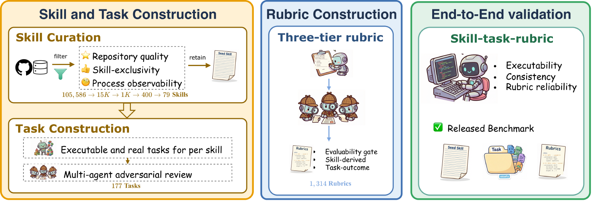
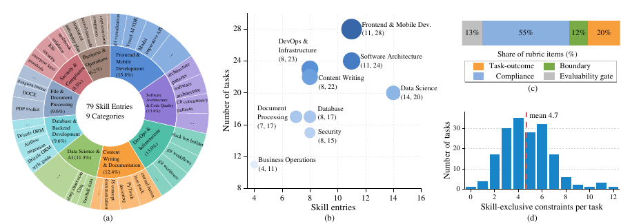

<div align="center">

# &nbsp;Skill-Use: Can LLMs Actually Use Skills in Agentic Harnesses?

<p>
  <a href="https://arxiv.org/pdf/2608.04828v1"></a>
  <a href="./LICENSE"></a>
  <a href="./LICENSE"></a>
</p>

<p>
  <b>79</b> real skills&nbsp;·&nbsp;<b>177</b> executable tasks&nbsp;·&nbsp;<b>177</b> trajectory rubrics&nbsp;·&nbsp;<b>9</b> domains&nbsp;·&nbsp;<b>2</b> agent harnesses
</p>

</div>

**Skill-Use** measures whether an LLM agent can actually *recognize*, *follow*, and *stay within* a skill under progressive disclosure. Given only a skill's name and short description, the agent has to decide the skill is relevant, retrieve its full procedure, and then apply it faithfully. Skill-Use grades the entire *trajectory*, not just the final answer, and decomposes theability into three separately observable facets:


- **Trigger** — does the agent invoke the relevant skill?
- **Compliance** — does it faithfully follow the prescribed procedure?
- **Boundary** — does it avoid the forbidden operations?

<div align="center">
  
  <br/><em>Data construction pipeline: 79 real skills paired with 177 executable tasks and 177 trajectory rubrics across 9 domains.</em>
</div>


## Benchmark


Skill-Use spans nine domains and pairs each skill with an in-scope executable task and a trajectory rubric. The 177 rubrics carry **1,314 scoring items** (avg. 7.4 per rubric, range 3–16), of which **882 are skill-derived** and enter Compliance and Boundary.

<div align="center">
  
  <br/><em>(a) Domain distribution over 79 skills. (b) Skill and task counts per domain. (c) Rubric item composition by type. (d) Skill-exclusive requirements per task (mean = 4.8).</em>
</div>

## Main Results

We evaluate **eight frontier LLMs** from seven families under two agent harnesses. All metrics are in `[0, 1]`. `Compliance†` and `Boundary†` are restricted to traces that trigger the target skill; `SU⁺` is the SU restricted to those triggered traces. 🏆 marks the best SU under each harness.

<table>
<thead>
<tr>
<th align="center">Harness</th>
<th align="left">Model</th>
<th align="center">Trigger</th>
<th align="center">Comp.</th>
<th align="center">Bound.</th>
<th align="center"><b>SU</b></th>
<th align="center">Comp.†</th>
<th align="center">Bound.†</th>
<th align="center"><b>SU⁺</b></th>
</tr>
</thead>
<tbody>
<tr><td rowspan="8" align="center"><b>Claude Code</b></td>
<td>Claude Opus 4.7</td><td align="center">0.966</td><td align="center">0.609</td><td align="center">0.712</td><td align="center">0.599</td><td align="center">0.606</td><td align="center">0.709</td><td align="center">0.637</td></tr>
<tr><td>Claude Opus 4.8</td><td align="center">0.940</td><td align="center"><b>0.625</b></td><td align="center">0.704</td><td align="center">0.597</td><td align="center"><b>0.638</b></td><td align="center">0.710</td><td align="center"><b>0.660</b></td></tr>
<tr><td>🏆 GPT-5.5</td><td align="center"><b>0.972</b></td><td align="center">0.611</td><td align="center"><b>0.718</b></td><td align="center"><b>0.613</b></td><td align="center">0.625</td><td align="center"><b>0.723</b></td><td align="center">0.654</td></tr>
<tr><td>DeepSeek-V4-Pro</td><td align="center">0.324</td><td align="center">0.439</td><td align="center">0.658</td><td align="center">0.250</td><td align="center">0.588</td><td align="center">0.699</td><td align="center">0.621</td></tr>
<tr><td>GLM-5.1</td><td align="center">0.324</td><td align="center">0.455</td><td align="center">0.639</td><td align="center">0.267</td><td align="center"><b>0.638</b></td><td align="center">0.632</td><td align="center">0.636</td></tr>
<tr><td>MiniMax-M3</td><td align="center">0.833</td><td align="center">0.569</td><td align="center">0.706</td><td align="center">0.501</td><td align="center">0.592</td><td align="center">0.698</td><td align="center">0.624</td></tr>
<tr><td>Kimi-K2.6</td><td align="center">0.337</td><td align="center">0.447</td><td align="center">0.580</td><td align="center">0.190</td><td align="center">0.576</td><td align="center">0.464</td><td align="center">0.542</td></tr>
<tr><td>Qwen3.6-Max</td><td align="center">0.446</td><td align="center">0.475</td><td align="center">0.625</td><td align="center">0.318</td><td align="center">0.590</td><td align="center">0.650</td><td align="center">0.608</td></tr>
<tr><td rowspan="8" align="center"><b>Codex</b></td>
<td>Claude Opus 4.7</td><td align="center">0.836</td><td align="center"><b>0.604</b></td><td align="center">0.705</td><td align="center">0.535</td><td align="center"><b>0.626</b></td><td align="center"><b>0.724</b></td><td align="center"><b>0.655</b></td></tr>
<tr><td>🏆 Claude Opus 4.8</td><td align="center">0.881</td><td align="center">0.599</td><td align="center"><b>0.715</b></td><td align="center"><b>0.559</b></td><td align="center">0.626</td><td align="center">0.721</td><td align="center">0.654</td></tr>
<tr><td>GPT-5.5</td><td align="center"><b>0.966</b></td><td align="center">0.486</td><td align="center">0.700</td><td align="center">0.503</td><td align="center">0.490</td><td align="center">0.709</td><td align="center">0.556</td></tr>
<tr><td>DeepSeek-V4-Pro</td><td align="center">0.650</td><td align="center">0.496</td><td align="center">0.653</td><td align="center">0.379</td><td align="center">0.571</td><td align="center">0.701</td><td align="center">0.610</td></tr>
<tr><td>GLM-5.1</td><td align="center">0.706</td><td align="center">0.525</td><td align="center">0.617</td><td align="center">0.421</td><td align="center">0.599</td><td align="center">0.616</td><td align="center">0.604</td></tr>
<tr><td>MiniMax-M3</td><td align="center">0.864</td><td align="center">0.475</td><td align="center">0.632</td><td align="center">0.446</td><td align="center">0.497</td><td align="center">0.655</td><td align="center">0.544</td></tr>
<tr><td>Kimi-K2.6</td><td align="center">0.706</td><td align="center">0.489</td><td align="center">0.623</td><td align="center">0.374</td><td align="center">0.529</td><td align="center">0.614</td><td align="center">0.554</td></tr>
<tr><td>Qwen3.6-Max</td><td align="center">0.684</td><td align="center">0.266</td><td align="center">0.573</td><td align="center">0.238</td><td align="center">0.304</td><td align="center">0.571</td><td align="center">0.384</td></tr>
</tbody>
</table>

> - The best model–harness pair reaches an SU of only **0.613**. Even restricted to triggered traces, the top `Comp.†` is **0.638** — models miss steps *after* they enter the skill.
> - Boundary is higher than Compliance in almost every row: models refrain from forbidden operations more easily than they finish the prescribed workflow.
> - Rankings shift with the harness. GPT-5.5 leads under Claude Code, Claude Opus 4.8 leads under Codex. Skill use is a property of the *model + harness*, not of the model alone.


## Repository Layout

```
Skill-Use-Bench/
├── benchmark/
│   ├── <skill_name>/
│   │   ├── skill/skill.md            # rewritten skill document (source form)
│   │   ├── tasks/*.yaml              # task definitions
│   │   ├── rubrics/rubric_*.yaml# trajectory rubric, 1:1 with tasks
│   │   └── assets/<TASK_ID>/         # real files staged into the sandbox
│   ├── _mapping.json                # source_dir ↔ target_name provenance
│   └── _scripts/                     # scoring engine (score_trace / score_matrix)
├── evaluation/
│   ├── docker/                       # sandbox + task-runner images
│   ├── tasks/                        # run_task.sh / run_batch.sh entrypoints
│   └── evaluate/                     # host-side batch scoring helpers
├── assets/                           # figures used by this README
└── README.md
```

Skill directories are keyed by the `name:` field of their `SKILL.md`. The runtime stages each skill to `.claude/skills/<name>/SKILL.md` so both Claude Code and Codex CLIs pick it up.

## Setup

```bash
git clone https://github.com/JinyiHan99/Skill-Use-Bench.git
cd Skill-Use-Bench

# Expand nested-Git fixtures used by code-review-expert / git-workflows /
# using-git-worktrees. Idempotent; safe to re-run.
bash benchmark/_scripts/restore_fixtures.sh

pip install pyyaml openai
docker build -t skill-use-bench:latest        -f evaluation/docker/Dockerfile      .
docker build -t skill-use-bench-runner:latest -f evaluation/docker/Dockerfile.task .
```

Skill-Use-Bench talks to the official APIs directly — no internal gateway is required.

```bash
export ANTHROPIC_API_KEY=sk-ant-...    # for --harness cc
export OPENAI_API_KEY=sk-...           # for --harness codex / codex-native
```

## Run

```bash
bash evaluation/tasks/run_task.sh \
    --skill   pdftk-server \
    --task    SF03_t1_merge_unordered \
    --model   claude-opus-4-8 \
    --harness cc                # cc | codex | codex-native
```

Outputs land in `runs/<harness>/<model>/<task_id>/` as `trace.jsonl`, `answer.txt`, `meta.json`. For batch evaluation, feed a JSONL manifest (`{"skill": ..., "task": ...}` per line) to `evaluation/tasks/run_batch.sh`.

| Harness         | Channel                                                        |
| :---            | :---                                                           |
| `cc`            | Claude Code, native progressive disclosure                |
| `codex`         | Codex, skill body preloaded into `.codex/instructions.md`      |
| `codex-native`  | Codex, skill installed under `$CODEX_HOME/skills/` with metadata only |

## Score

```bash
python benchmark/_scripts/score_trace.py \
    --trace  runs/cc/<model>/<task_id>/trace.jsonl \
    --rubric benchmark/<skill_name>/rubrics/rubric_<task>.yaml \
    --out    runs/cc/<model>/<task_id>/score.json \
    --judge-model gpt-5

python benchmark/_scripts/score_matrix.py --runs-root runs/ --out leaderboard.csv
```

`score_matrix.py` emits per-model Trigger, Compliance, Boundary, gated SU, plus the triggered-only variants `Comp.†`, `Bound.†`, and `SU⁺`.

## Citation

```bibtex
@misc{han2026skilluse,
  title         = {Skill-Use: Can LLMs Actually Use Skills in Agentic Harnesses?},
  author        = {Jinyi Han and Yuanjian Xu and Ying Liao and Xinyi Wang
                   and Zishang Jiang and Zixiang Di and Fanyang Lu
                   and Zhichao Hu and Yanghua Xiao},
  year          = {2026},
  eprint        = {2608.04828},
  archivePrefix = {arXiv},
  primaryClass  = {cs.CL},
  doi           = {10.48550/arXiv.2608.04828},
  url           = {https://arxiv.org/abs/2608.04828}
}
```

